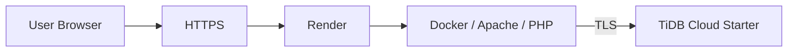
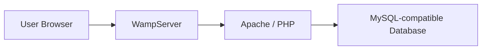

# KinderVault

**KinderVault: A Secure Preschool Management System** is a web-based preschool management system developed to centralize daily preschool administrative activities while applying practical cybersecurity controls.

The system combines student management, payment monitoring, digital receipts, student development tracking, role-based access control, audit logging, Multi-Factor Authentication, secure session management, and database backup within a single web platform.

---

## Live Deployment

KinderVault is currently deployed online using **Render** with **TiDB Cloud Starter** as its MySQL-compatible cloud database.

[Open KinderVault Online](https://kindervault.onrender.com/index.php)

> Access to system functions depends on the user account, assigned role, permissions, and Multi-Factor Authentication configuration.

---

## Project Overview

Preschool administrative information is often distributed across paper records, spreadsheets, messaging applications, and separate manual workflows.

This can make student information, payment records, receipts, and development progress more difficult to organize, monitor, and protect.

KinderVault provides a centralized web-based environment for managing these activities in a structured and secure manner.

The system focuses on two main areas:

1. Improving daily preschool administrative workflows.
2. Applying security controls to protect sensitive preschool information.

---

# Key Features

## Student Management

KinderVault allows authorized users to:

- Register new students.
- View student records.
- Search student information.
- Update student profiles.
- Manage student status.
- Store parent and guardian information.
- Assign students to classes.
- Configure monthly packages.
- Enable optional monthly Iqra fees.
- Maintain selected annual fee information.

Supported student statuses include:

- Active
- Inactive
- Graduated

Inactive and graduated students can retain historical records without remaining active in current payment workflows.

---

## Class Management

The system provides class roster management for existing preschool classes.

Users can:

- View students according to class.
- Review class rosters.
- Navigate directly to student profiles.
- Configure class names through system settings.

---

## Payment Management

KinderVault provides structured payment monitoring for preschool fees.

Users with the required permissions can:

- Record payments.
- Monitor monthly fees.
- View payment history.
- Monitor outstanding balances.
- Record partial payments.
- Record advance payments.
- Manage monthly fee periods.
- Record different supported payment methods.
- Void incorrect completed transactions while preserving the historical record.

Supported payment statuses include:

| Status | Description |
|---|---|
| Paid | The required payment has been fully completed |
| Partial | Part of the required payment has been received |
| Unpaid | The current payment obligation remains unpaid |
| Overdue | A previous payment obligation remains unpaid |
| Advance | A future payment period has been fully covered |
| Voided | The original transaction has been cancelled while its history is retained |

---

## Digital Receipts

KinderVault generates digital receipt records from completed payment transactions.

Users can:

- View receipt information.
- Review student and payment details.
- Access previous receipts.
- Print receipts.
- Save receipts as PDF using the browser print function.

Receipt records remain connected to the relevant payment transaction for easier administrative review.

---

## WhatsApp Payment Reminder

KinderVault can prepare payment reminder messages for parents or guardians.

The system:

1. Retrieves the available guardian contact number.
2. Generates a prepared payment reminder message.
3. Opens WhatsApp or WhatsApp Web.
4. Allows the authorized user to review the message.
5. Requires the user to manually send the message.

KinderVault **does not automatically send WhatsApp messages**.

This keeps the staff member in control of communication before a message is sent.

---

# Student Development

KinderVault includes features for monitoring preschool student development.

## Reading Progress

Authorized users can record:

- Bahasa Melayu reading progress.
- English reading progress.
- Book level.
- Last completed page.
- Assessment date.
- Teacher notes.

Existing records can also be searched, filtered, edited, printed, or reviewed according to user permissions.

---

## KPM Development Checklist

The system includes a structured development checklist for monitoring student progress.

Users can:

- Create new assessments.
- Select an eligible student.
- Record the assessment date.
- Record the assessment location.
- Record assessor information.
- Mark development items as:
  - Achieved
  - Not Achieved
- Add notes.
- Save the assessment.
- Generate printable checklist output.

---

# Search

KinderVault provides centralized search functionality.

Search results are limited by the permissions of the currently authenticated user.

Depending on access rights, results may include:

- Student records
- Payment information
- Receipts
- Classes
- Student development records
- Reading progress

This helps users quickly locate relevant information without exposing records that they are not authorized to access.

---

# Language Support

KinderVault supports:

- English
- Bahasa Melayu

The interface language can be changed directly from the application.

The user's selected language preference is maintained according to the current implementation.

---

# Theme

The interface supports:

- Light theme
- Dark theme

Theme preference affects interface appearance only and does not change application data.

---

# Security

Security is a major focus of KinderVault.

The system applies multiple layers of protection instead of relying on a single security mechanism.

The implemented security controls include:

- Password hashing
- Multi-Factor Authentication
- TOTP replay protection
- Recovery codes
- MFA secret encryption
- Role-Based Access Control
- Backend authorization
- Failed-login protection
- Account lockout
- Session timeout
- Password security policies
- CSRF protection
- Input validation
- Prepared SQL statements
- Audit logging
- Environment-based secret management
- TLS-protected database communication
- Controlled database backup procedures

---

## Password Security

KinderVault does not store normal user passwords as readable plaintext.

Application passwords are protected using:

**bcrypt password hashing**

The application uses a bcrypt cost factor of:

```text
12
```

Password hashing is one-way, meaning the original password cannot simply be retrieved from the stored hash.

Security settings can also enforce supported password requirements such as:

- Minimum password length
- Uppercase characters
- Lowercase characters
- Numeric characters
- Additional complexity requirements where enabled

---

## Multi-Factor Authentication

KinderVault supports **Time-Based One-Time Password Multi-Factor Authentication (TOTP MFA)**.

Users can configure MFA with compatible authenticator applications such as:

- Google Authenticator
- Microsoft Authenticator

After username and password authentication, users with MFA enabled must provide a valid time-based verification code before accessing the system.

This provides an additional authentication layer beyond the password.

---

## MFA Recovery Codes

KinderVault supports recovery codes for MFA-enabled accounts.

Recovery codes provide an alternative method of authentication when the normal authenticator application is unavailable.

Recovery codes are:

- Designed for emergency account access.
- Single-use.
- Required to be stored securely.

Used recovery codes cannot be reused.

---

## TOTP Replay Protection

KinderVault includes protection against repeated use of an already accepted TOTP authentication code.

When a valid TOTP time step has already been accepted, the application can prevent that same authentication value from being reused.

This reduces the risk of replaying a recently captured MFA code.

---

## MFA Secret Encryption

TOTP requires the application to retain an MFA secret for verification.

Unlike passwords, the MFA secret cannot be stored only as a one-way hash because the application must use it when validating authentication codes.

KinderVault therefore encrypts MFA secrets before storage.

The encryption key is supplied separately through environment configuration.

The application uses:

```text
KINDERVAULT_MFA_KEY
```

The real encryption key must never be stored directly in the public repository.

---

## Administrator MFA Requirement

KinderVault includes security configuration for requiring MFA on Administrator accounts.

This allows high-privilege accounts to receive additional authentication protection.

Because Administrator accounts can manage security configuration, users, permissions, audit logs, and backup functions, protecting these accounts is especially important.

---

## Failed Login Protection

KinderVault monitors unsuccessful authentication attempts.

Security configuration can control:

- Maximum failed login attempts.
- Temporary account lockout.
- Account lockout duration.

Repeated incorrect login attempts can therefore trigger temporary access restrictions.

This helps reduce password-guessing and brute-force attempts.

---

## Generic Authentication Errors

Authentication responses are designed to avoid unnecessarily revealing whether:

- A username exists.
- A password is incorrect.
- An account is disabled.
- An account is locked.

Using generic login error messages reduces unnecessary information disclosure to unauthorized users.

---

## Session Security

KinderVault uses authenticated sessions to maintain user access.

Session security controls include:

- Session authentication.
- Inactivity timeout.
- Session expiration.
- Logout handling.
- Access checks for protected pages.
- Configurable session timeout settings.

If a session expires, the user must authenticate again before continuing.

---

# Role-Based Access Control

KinderVault uses **Role-Based Access Control (RBAC)**.

Three primary roles are available:

| Role | General Access |
|---|---|
| Administrator | Full system administration and security management |
| Teacher | Access to permitted student and development functions |
| Authorized Staff | Access to functions assigned through the permission system |

Access can be configured according to the operational requirements of the preschool.

Individual user permissions may also be adjusted when necessary.

---

## Backend Authorization

KinderVault does not rely only on visually hiding menu items.

Permission checks are also applied to protected operations at the backend.

This is important because simply hiding an Administrator menu does not securely prevent someone from manually entering an administrative URL.

KinderVault therefore validates whether the authenticated user has permission before allowing protected operations.

Unauthorized users are denied access.

---

# User and Permission Management

Administrators can manage system accounts through the administrative interface.

Available functions include:

- Create user accounts.
- Assign roles.
- Configure permissions.
- Apply individual permission overrides.
- Reset passwords.
- Activate accounts.
- Deactivate accounts.
- Review user access settings.

Each staff member should use an individual account so that access control and audit records remain meaningful.

---

# CSRF Protection

KinderVault applies **Cross-Site Request Forgery protection** to supported state-changing requests.

CSRF tokens help verify that an important request originated from the legitimate KinderVault session.

This reduces the risk of an external website causing an authenticated user to unknowingly perform an unauthorized action.

---

# SQL Injection Protection

KinderVault uses **PDO prepared statements** for database operations.

Prepared statements separate:

- SQL instructions
- User-provided values

This helps reduce the risk of SQL injection attacks.

Where applicable, database operations are performed using parameterized queries rather than directly inserting user input into SQL statements.

---

# Input Validation

KinderVault validates user-supplied information before supported operations are processed.

Examples include validation of:

- Required fields
- Student information
- Dates
- Payment values
- User information
- Authentication information
- Development records

Validation helps reduce invalid data and unexpected application behaviour.

---

# Audit Logging

KinderVault includes an administrative Audit Log.

Security-relevant and important system activities can be recorded for review and traceability.

Administrators can review audit information such as:

- Date and time
- User
- User role
- Module
- Action
- Status
- Event details

The Audit Log supports administrative accountability and investigation of system activity.

Audit records are intended for review and are not normally editable through the interface.

---

# Environment-Based Secret Management

Sensitive production information should not be hard-coded into the application source code.

KinderVault uses environment-based configuration for sensitive settings.

Examples include:

```text
DB_HOST
DB_PORT
DB_NAME
DB_USER
DB_PASSWORD
KINDERVAULT_MFA_KEY
```

Depending on deployment configuration, additional environment values may also be used.

The following information must never be committed publicly:

- Database passwords
- Production connection strings
- MFA encryption keys
- MFA secrets
- Recovery codes
- API credentials
- Private certificates
- Real user passwords
- Authentication tokens

---

# Database Connection Security

The hosted KinderVault application communicates with its external cloud database using TLS-protected connectivity.

The deployed architecture is approximately:

```text
User Browser
    ↓ HTTPS

Render
    ↓

Docker / Apache / PHP
    ↓ TLS

TiDB Cloud Starter
```

HTTPS protects communication between the user's browser and the hosted web application.

TLS protects supported database communication between the application environment and the cloud database.

KinderVault does **not** claim that the entire database is encrypted at rest by the application itself.

---

# Database Backup

Authorized Administrators can export a database backup as an SQL file.

Backup files may contain sensitive information including:

- Student records
- Parent or guardian information
- Payment information
- Development records
- Administrative data

Backup files should therefore be stored in a secure location with restricted access.

The current KinderVault web interface provides backup export and recovery guidance.

It does not provide direct production SQL upload and database restoration through the browser.

Database recovery should be performed through an authorized administrative process using appropriate database tools.

---

# System Architecture

## Production Environment

KinderVault is deployed using the following architecture:



The production application is hosted on Render while TiDB Cloud Starter provides the MySQL-compatible database environment.

---

## Local Development Environment

KinderVault can also run locally using WampServer.



---

# Technology Stack

| Component | Technology |
|---|---|
| Backend | PHP |
| Database Interface | PDO |
| Frontend | React 18, JavaScript, JSX, CSS |
| Web Server | Apache |
| Local Environment | WampServer |
| Local Database | MySQL-compatible database |
| Production Hosting | Render |
| Cloud Database | TiDB Cloud Starter |
| Containerization | Docker |
| Authentication | Session authentication + TOTP MFA |
| Password Protection | bcrypt |
| Version Control | Git / GitHub |
| Production Web Security | HTTPS |
| Database Transport Security | TLS |

---

# Local Development Setup

## Requirements

Recommended development environment:

- Windows
- WampServer
- Apache
- PHP
- MySQL or compatible database
- Git
- Node.js and npm when rebuilding frontend scripts
- Modern web browser

The Docker deployment environment uses PHP 8.3.

---

## 1. Clone the Repository

```powershell
cd C:\wamp64\www
git clone https://github.com/Zythraa/kindervault.git
cd kindervault
```

---

## 2. Configure the Database

Create or prepare the MySQL-compatible database required by KinderVault.

Configure the required database environment values:

```text
DB_HOST
DB_PORT
DB_NAME
DB_USER
DB_PASSWORD
```

Do not commit real production credentials.

---

## 3. Import the Database Schema

The database schema is available under:

```text
database/schema.sql
```

The schema can be imported using compatible database administration tools such as:

- phpMyAdmin
- Adminer
- MySQL command-line tools

---

## 4. Configure the MFA Encryption Key

Configure:

```text
KINDERVAULT_MFA_KEY
```

using the operating system, server, or hosting environment.

Use a securely generated value and keep it outside the repository.

---

## 5. Start the Local Environment

Start WampServer and ensure:

- Apache is running.
- MySQL is running.

Then open:

```text
http://localhost/kindervault/login.php
```

---

# Building Frontend Scripts

When modifying JSX frontend source files, install the required dependencies:

```powershell
npm install
```

Then build the browser-ready JavaScript:

```powershell
npm run build:js
```

Node.js is primarily used during the frontend build process.

The production KinderVault application is served through PHP and Apache rather than a Node.js application server.

---

# Deployment

KinderVault is currently deployed using:

- GitHub
- Render
- Docker
- Apache
- PHP
- TiDB Cloud Starter

The live application is available at:

[https://kindervault.onrender.com/index.php](https://kindervault.onrender.com/index.php)

Deployment-related repository files may include:

```text
Dockerfile
render.yaml
```

Production credentials and security keys must be configured through the hosting environment instead of being committed to the repository.

---

# User Manual

A complete KinderVault User Manual is available here:

[View KinderVault User Manual](https://drive.google.com/file/d/1TmXG9RyRwstUBO8psqbeDmoRgvBuRph4/view?usp=sharing)

The User Manual covers:

- System access
- Login
- Multi-Factor Authentication
- Session security
- Dashboard
- Student management
- Class management
- Payment management
- Partial and advance payments
- Digital receipts
- WhatsApp payment reminders
- Reading progress
- KPM Development Checklist
- Search
- Language selection
- Theme settings
- User management
- Roles and permissions
- Security settings
- Audit log
- Database backup
- Troubleshooting
- Current limitations
- System requirements

---

# Current Limitations

The current KinderVault implementation has the following known user-facing limitations:

- No self-service Forgot Password function.
- Password resets must be performed by an Administrator.
- No integrated online payment gateway.
- Payments are recorded after payment is received through the preschool's existing payment method.
- No complete parent or guardian portal.
- No attendance management module.
- No native mobile application.
- WhatsApp reminders must be manually reviewed and sent by staff.
- No direct production database restore through the web application.
- The Classes page does not directly provide Add Class or Delete Class functions.
- Receipts use the browser print function for PDF saving.
- Some wide tables and forms may be less convenient on small mobile screens.
- Scanner-related functionality is not exposed as a current production feature.
- Chatbot components are not exposed as a current production feature.

---

# Security Summary

KinderVault uses a **defence-in-depth approach** by applying multiple security controls across authentication, authorization, application processing, database communication, and auditing.

Major controls include:

| Security Area | Implemented Control |
|---|---|
| Password Protection | bcrypt hashing |
| Additional Authentication | TOTP MFA |
| MFA Secret Protection | Encrypted storage |
| MFA Replay Protection | Previously accepted TOTP step protection |
| Emergency MFA Access | Single-use recovery codes |
| Login Protection | Failed-attempt tracking and temporary lockout |
| Session Protection | Inactivity timeout and session expiration |
| Authorization | Role-Based Access Control |
| Backend Protection | Server-side permission checks |
| Request Protection | CSRF tokens |
| Database Query Protection | PDO prepared statements |
| Input Protection | Server-side validation |
| Activity Monitoring | Audit logging |
| Secret Management | Environment variables |
| Browser Communication | HTTPS |
| Database Communication | TLS |
| Recovery | Controlled SQL backup export |

Security configuration should still be reviewed according to the requirements of the environment where KinderVault is deployed.

---

# Repository Access

This repository is provided for project review, demonstration, and reference.

Users may:

- View the repository.
- Review the source code.
- Clone the repository.
- Download the repository.
- Create their own fork where permitted by GitHub.

Users cannot directly modify or push changes to the original repository unless they have been explicitly granted repository write access.

---

# Disclaimer

KinderVault was developed as an academic software project with a strong focus on secure web application development.

The repository may contain components used for:

- Development
- Testing
- Deployment
- Demonstration
- Security implementation
- Academic evaluation

Before using the system with real operational or personal information, the deployment environment, access-control configuration, security settings, backup procedures, and applicable data-protection requirements should be reviewed.

---

# License

No separate open-source license is currently provided for this repository.

**All rights reserved unless otherwise stated.**
